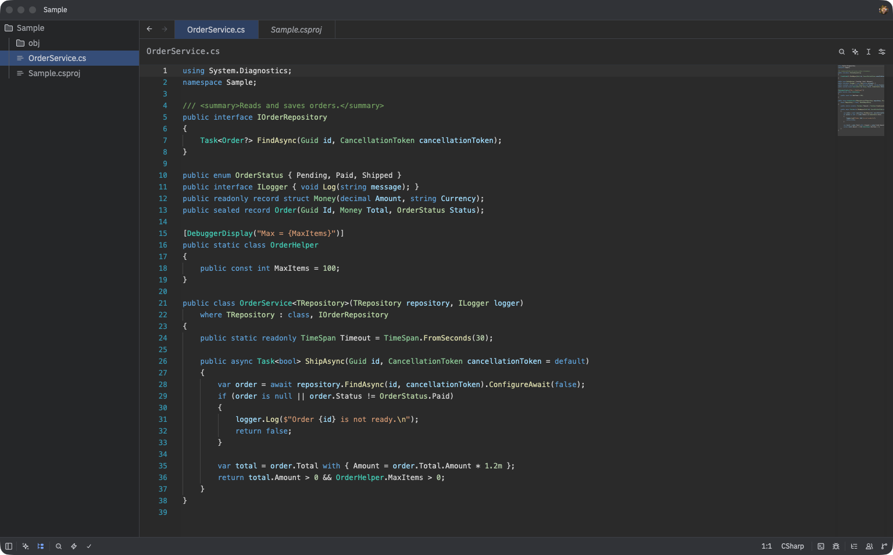
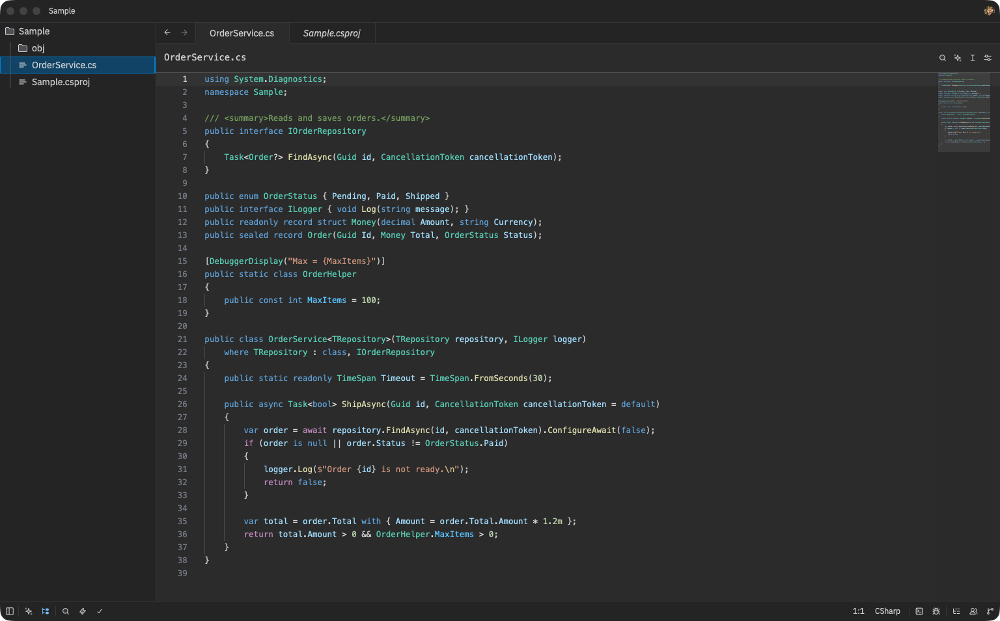

# Legacy .NET theme for Zed

A dark theme for .NET developers.

## Compared to VSCode Dark Modern

Both shots show the same C# file with semantic tokens on.

**Legacy .NET Dark** gives each kind of type its own color: classes, interfaces, structs, enums and type parameters.



**VSCode Dark Modern** uses one color for all types.



## Install

From the Zed extensions page, search for `Legacy .NET`. Then pick `Legacy .NET Dark` in `theme selector: toggle`.

To test a local copy, run `zed: install dev extension` and select this folder.

## Full C# colors

Interfaces, structs, enums and type parameters each get their own color. This needs semantic tokens from the C# language server. Turn them on in `settings.json`:

```json
"languages": {
  "CSharp": {
    "semantic_tokens": "combined"
  }
}
```

Without this setting, all types share one color.

## License

[MIT](LICENSE)
